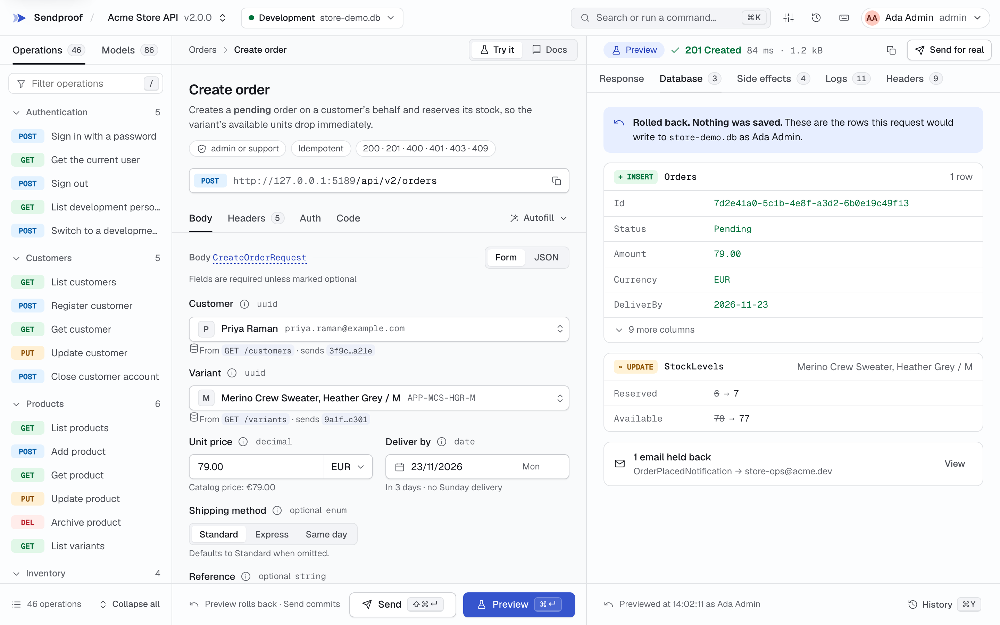

# Test Bench

Test Bench mounts an OpenAPI workbench at `/bench` inside an API. Choose an operation, edit typed inputs, then use **Preview** to see its response and the database changes the provider rolls back. **Send** calls the ordinary API endpoint as the current user. See the [binding guide](docs/bindings/README.md) for framework and provider support.



[API overview](mocks/screens/48-api-overview-signed-out.png) · [Docs](mocks/screens/24-docs.png) · [Models](mocks/screens/27-model-payment.png) · [Dark theme](mocks/screens/02-request-default-dark.png) · [Arabic, right to left](mocks/screens/46-rtl-ar.png) · [Mobile](mocks/screens/m01-request.png)

## Run the example

From a fresh clone with the .NET 10 SDK installed:

```sh
dotnet run --project examples/TreasuryApi
```

Open **http://localhost:5080/bench**. The API overview explains Preview and Send. Sign in as Ada Admin, select **Create payment**, and choose **Autofill → Fill required fields** (or press the wand in any field for a value within its schema, or a deliberately invalid one). Preview it and check **Database** for the rolled-back changes and **Side effects** for the held email. Send the same request to create the payment: in Development, Send is traced, so the same tabs show what was committed. Then follow **Get payment** from its response. Press **D** for an operation's Docs, open **Models** in the sidebar for every schema, and use **Display settings** (⌘, or Ctrl+,) for density, theme and language (English, German or Arabic). The sample creates its own SQLite database. Its sign-in details and database settings are in the [example guide](examples/TreasuryApi/README.md).

## Packages

| NuGet package | What it adds |
| --- | --- |
| `TestBench.AspNetCore` | The embedded workbench, authentication discovery and Preview protocol for .NET 10. |
| `TestBench.EntityFrameworkCore` | Relational transaction rollback and tracked row changes for one scoped EF Core context. Includes the ASP.NET Core adapter as a dependency. |

To try the first prerelease from this checkout, build both packages and install from the local feed. Keep nuget.org enabled for third-party dependencies.

```sh
dotnet pack adapters/dotnet/TestBench.AspNetCore -c Release -o artifacts/packages
dotnet pack adapters/dotnet/TestBench.EntityFrameworkCore -c Release -o artifacts/packages
dotnet add /path/to/YourApi.csproj package TestBench.EntityFrameworkCore --version 0.1.0-alpha.1 --no-restore
dotnet restore /path/to/YourApi.csproj --source "$PWD/artifacts/packages" --source https://api.nuget.org/v3/index.json
```

For a feed that persists across restores, see the [package guide](docs/packages.md).

## Add it to an API

Reference `TestBench.AspNetCore` and `TestBench.EntityFrameworkCore` from the solution or a local NuGet feed. The example uses project references. For an API that already registers its OpenAPI document, authentication, and scoped EF Core context, add:

```csharp
using TestBench.AspNetCore;
using TestBench.EntityFrameworkCore;

builder.Services.AddTestBench()
    .AddEntityFrameworkCore<TreasuryDbContext>();

// After building the app, alongside app.MapOpenApi() and your routes:
app.MapTestBench();
```

The workbench reads `/openapi/v1.json`. New endpoints and changed schemas appear when you reload it after rebuilding the API. The package embeds the web assets. Consumers need only the .NET tooling they already use.

Preview is available for routes the application declares safe to roll back. Apply `.WithTestBenchPreview()` to a minimal API endpoint, or `[TestBenchPreview]` to an MVC action, whose writes use the registered context and whose external effects are accounted for. Remaining routes can still use Send. The [EF provider guide](adapters/dotnet/TestBench.EntityFrameworkCore/README.md) explains the scope of the database diff.

## Configure a hosted development API

```csharp
builder.Services.AddTestBench()
    .InEnvironments("Development", "HostedDevelopment")
    .WithOpenApiUrl("/openapi/internal.json")
    .WithAuthProvider("Company SSO", "oidc", "/account/sign-in")
    .AddEntityFrameworkCore<TreasuryDbContext>();
```

Use the URL of the host's sign-in action. Displayable remote authentication schemes can also be discovered by the adapter. Both local and hosted development can use SSO. The host owns its users, callbacks and policies. An application with a named access policy can apply it to the workbench with `.RequireAuthorization("ApiDevelopers")`.

## Develop and contribute

- [Build, test and release workflow](.github/workflows/check.yml)
- [Package installation and compatibility](docs/packages.md)
- [NuGet registration and release procedure](docs/releasing.md)
- [Changelog](CHANGELOG.md)
- [Proposal and design decisions](PROPOSAL.md)
- [Adapter protocol](spec/README.md)
- [Contributor guide](CONTRIBUTING.md)
- [Report a security issue](SECURITY.md)
- [MIT license](LICENSE)
