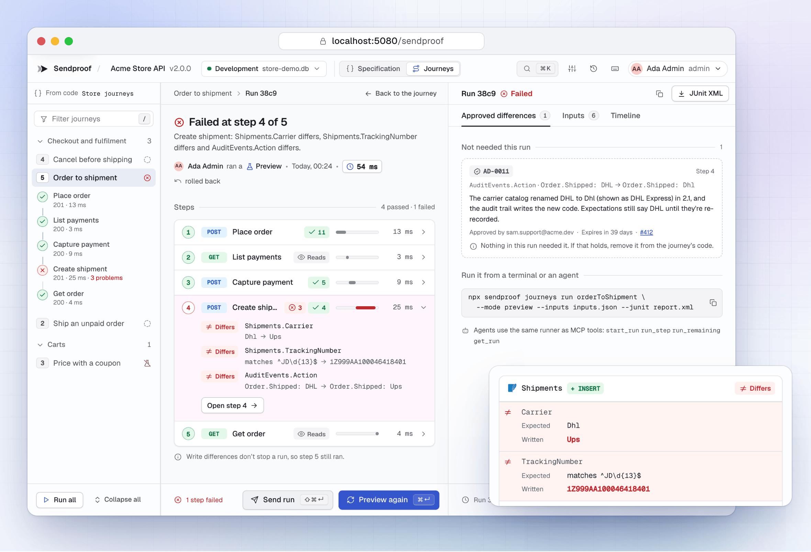
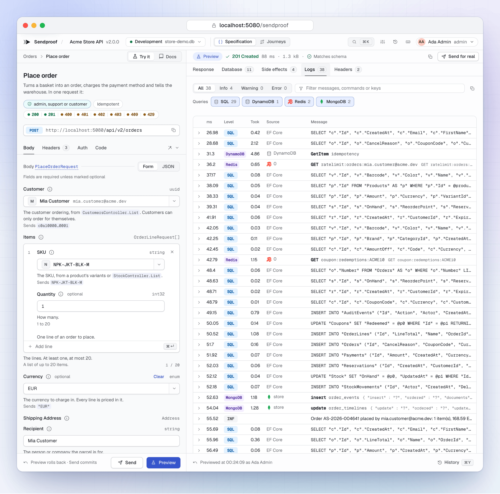
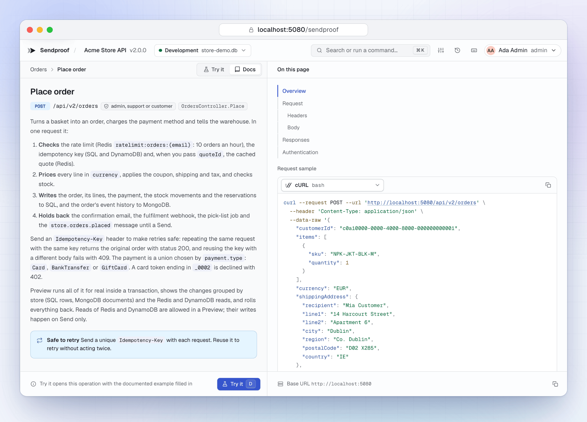
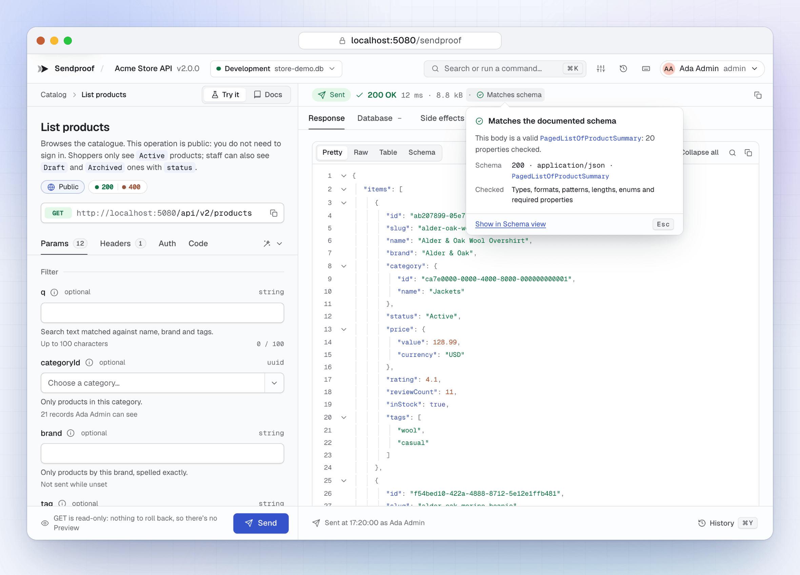
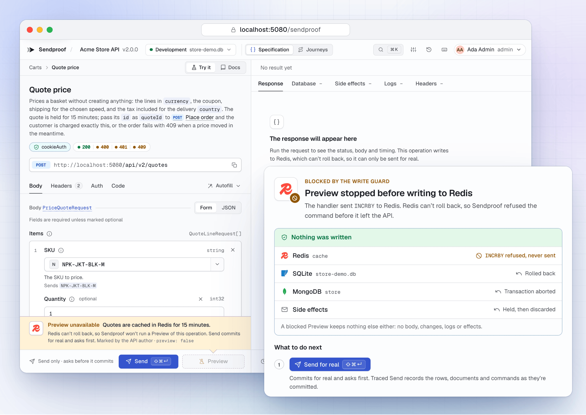
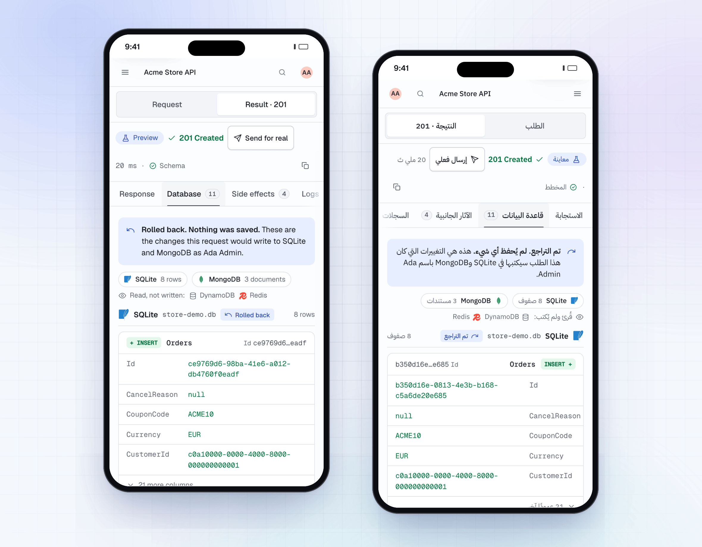
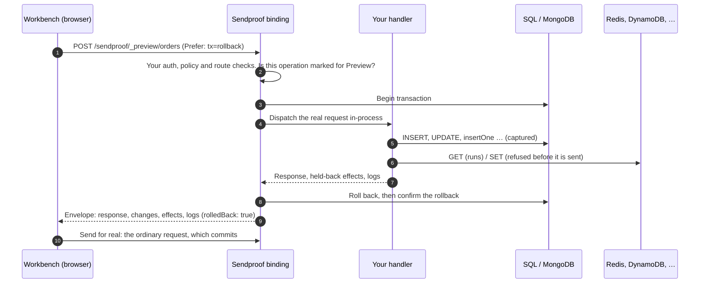

<div align="center">

# Sendproof

**See what an API call will change before you send it.**

An OpenAPI workbench that lives inside your API at `/sendproof`. **Preview** runs the real handler,
signed in as a real user, inside a transaction that is always rolled back, and shows you every row,
document, email and log line the request would produce. **Send for real** when it looks right.

[](https://github.com/mprync/sendproof/actions/workflows/check.yml)
[](LICENSE)
[](docs/bindings/databases.md)
[](CONTRIBUTING.md)

[](adapters/dotnet/Sendproof.AspNetCore)
[](adapters/node)
[](adapters/python)
[](adapters/java)
<br>
[](adapters/go)
[](adapters/php)
[](adapters/ruby)
[](adapters/rust)

[Quick start](#quick-start) · [Journeys](#journeys) · [How it works](#how-it-works) · [Safety model](#safety-model) · [Support matrix](#support-matrix) · [Comparison](#how-it-compares) · [FAQ](#faq)

</div>

<p align="center">
  <picture>
    <source media="(prefers-color-scheme: dark)" srcset="docs/images/hero-dark.png">
    
  </picture>
</p>

<p align="center">
  <b>Available in 29 languages</b>, including Arabic, Hebrew and Persian right to left:<br>
  English · Deutsch · Français · Español · Português · Italiano · Nederlands · Polski · Русский · Türkçe ·
  日本語 · 简体中文 · 繁體中文 · 한국어 · हिन्दी · العربية · עברית · فارسی · <a href="ui/locales/README.md">all 29</a>
</p>

> [!NOTE]
> The first release, `0.1.0-alpha.2`, is in preparation. The install commands below use the names
> the packages will be published under. Until then, `node tools/pack-all.mjs` builds every package
> from this checkout ([CONTRIBUTING.md](CONTRIBUTING.md#build-every-package)).

## Why Sendproof

Swagger UI's **Try it out** sends a real request: if the operation writes, it writes, and all you see is
the response. Collections in Postman, Insomnia or Bruno live outside the app, so you copy tokens into
them, keep a second list of endpoints in sync, and still can't see what a request did to the database
without opening another tool.

Sendproof runs inside the app instead. It reads the OpenAPI document you already serve, signs in
through your app's own sign-in (SSO, cookie sessions or seeded personas), and calls your endpoints
through your real routing, middleware and authorization. **Preview** adds the missing step: the
handler runs for real, then everything it wrote is rolled back, and you get the diff.

- **Write operations become safe to try.** Approve, refund, delete: preview them against your
  development data as many times as you like. Nothing is saved until you choose **Send for real**.
- **Permissions are tested, not assumed.** Switch to a read-only persona and Preview the same
  request to see the 403 your API really returns.
- **The diff is the documentation.** New teammates see which tables, documents and side effects an
  endpoint touches, from the endpoint itself.

## Features

| | |
| --- | --- |
| **Preview, then Send** | Run the real handler in a transaction that is always rolled back. See the response, the changed SQL rows (before and after), MongoDB documents as a field-level diff, held-back emails, webhooks and jobs, logs and every database command. Then send the same request for real. |
| **Changes grouped by store** | One Preview can span SQL and MongoDB. Each store gets its own section, and stores that were only read (Redis, DynamoDB and others) are listed as read, not written. |
| **Write guard** | Redis, DynamoDB, Cassandra, Elasticsearch, OpenSearch, Cosmos DB and Firestore can't roll back, so a write to them is refused before it leaves the app and the Preview stops with a clear explanation. Operations the API marks `preview: false` are Send only, and Send asks before it commits. |
| **Your auth, your users** | Uses the host's identity and policies. SSO works on localhost and hosted development. A persona switcher (when the app provides one) lets you try the same request as different roles. |
| **Typed request builder** | Forms generated from the schema, with lookups that fetch real IDs as the signed-in user, enums, dates, money with currency, arrays, `oneOf` variants, a JSON mode, Autofill with valid or deliberately invalid values, and field-level validation. |
| **Response viewer** | Pretty, raw, table and schema views, search, and a check that the body matches the documented schema. Follow links to related operations. |
| **Journeys** | Whole flows (an order through to shipment) written as code in your app, published as [Arazzo 1.1](https://spec.openapis.org/arazzo/v1.1.html). Run them in the workbench step by step or to the end on one Preview session that rolls back at the end, and compare what each step wrote with what it should have. The same runs work from the CLI in CI (JUnit XML), from an AI agent over MCP, and as xUnit tests. |
| **Docs and models** | A Docs view for every operation (press <kbd>D</kbd>) with request samples and response examples, and a Models tab with property trees, compositions and discriminators. |
| **Observed Send** | In development, a Send can be traced too: the same Database, Side effects and Logs tabs show what was committed. Traces are private to the user who sent them and expire after five minutes. |
| **Code export** | Copy the edited request as cURL, JavaScript, Python, C#, Go, Java, Kotlin, PHP, Ruby, Rust or PowerShell, with credentials masked. |
| **Built for real use** | Keyboard first (<kbd>⌘K</kbd> command search, <kbd>?</kbd> for shortcuts), light and dark themes, three densities, [29 interface languages](ui/locales/README.md) including Arabic, Hebrew and Persian right to left, and a phone layout. WCAG 2.2 AA is the release target. |
| **For AI agents too** | [`@sendproof/cli`](adapters/node/cli) is an MCP server: an agent can list and read operations, find real IDs, Preview any request and see exactly what it would write, and Send when you allow it, as the signed-in user or a development persona. It works with every adapter. |
| **Zero front-end setup** | Each package embeds the same prebuilt UI, verified by SHA-256. Your app needs no Node, no build step and no second list of endpoints. |

## Journeys

A journey is the ordered set of calls a person makes to finish a task, with what each call should
write. You define it in your app's own language, next to the endpoints it calls. Sendproof checks it
at startup and publishes it as an Arazzo 1.1 workflow. You can then run it anywhere:

- **In the workbench.** Switch to **Journeys**, then **Preview run**. Every step runs on one held
  Preview session, so step 3 sees what step 1 wrote, and the whole run rolls back at the end. Each
  step opens on its operation's own screen, with the values it got from earlier steps marked.
- **In CI.** `npx sendproof journeys run --all --junit report.xml` runs the same journeys against a
  development deployment. It exits non-zero when a step writes something it shouldn't.
- **From an agent.** The MCP server's `start_run`, `run_step` and `run_remaining` tools use the same runner.
  An agent can write a journey for you, run it, and draft an approved difference when a change is intended.

<picture>
  <source media="(prefers-color-scheme: dark)" srcset="docs/images/journeys-dark.png">
  
</picture>

In .NET, a journey is a class. Requests and responses are typed, and expectations name your
`DbContext` sets and document classes:

```csharp
public sealed class OrderToShipmentJourney : Journey<OrderToShipmentInputs>
{
    protected override void Define(JourneyBuilder<OrderToShipmentInputs> journey)
    {
        journey.Name("Order to shipment");
        journey.RunAs("ada.admin@acme.dev");

        var placeOrder = journey.Step("placeOrder", StoreOperations.Orders.Place);
        placeOrder.Set(r => r.Body.CustomerId, journey.Input(i => i.CustomerId));
        placeOrder.SucceedsWith(201);
        Ref<Guid> orderId = placeOrder.Output(order => order.Id, "orderId");

        var shipOrder = journey.Step("shipOrder", StoreOperations.Shipments.Create);
        shipOrder.Set(r => r.Body.OrderId, orderId);
        shipOrder.Set(r => r.Body.Carrier, journey.Input(i => i.Carrier));
        shipOrder.ExpectWrites(writes => writes.Sql<StoreDbContext>().Update(db => db.Orders)
            .Where(o => o.Id, orderId)
            .Set(o => o.Status, Match.Changed(OrderStatus.Paid, OrderStatus.Shipped)));
    }
}
```

`sendproof.AddJourneys(typeof(Program).Assembly)` registers every journey in the assembly
([Sendproof.Journeys](adapters/dotnet/Sendproof.Journeys/README.md)), and a one-line
`JourneyTestSuite<Program>` runs each one as an xUnit test
([Sendproof.Journeys.Testing](adapters/dotnet/Sendproof.Journeys.Testing/README.md)). Every other
adapter defines journeys in its own language too:
[Node.js](adapters/node/README.md#preview-sessions-and-journeys) ·
[Python](adapters/python/README.md#code-journeys) ·
[Java and Kotlin](adapters/java/README.md#preview-sessions-and-journeys) ·
[Go](adapters/go/README.md#preview-sessions-and-journeys) ·
[Ruby](adapters/ruby/README.md#preview-sessions-and-journeys) ·
[PHP](adapters/php/README.md#define-journeys-in-php) ·
[Rust](adapters/rust/README.md#journeys-in-rust).

### When a step writes something else

A write that differs doesn't stop the run, so you see every difference at once. Open the step to
see what it should have written next to what it wrote, field by field. When a change is intended,
record it as an **approved difference**: a reviewed record in the journey's code, with a reason,
an approver and an expiry date, so the journey passes until its expectations are updated.

<picture>
  <source media="(prefers-color-scheme: dark)" srcset="docs/images/difference-dark.png">
  
</picture>

## A closer look

### The whole request, command by command

The Logs tab lists the app's own log lines next to every SQL statement and MongoDB, Redis and DynamoDB
command the request ran, in order, with timings. Secret-named values are redacted.

<picture>
  <source media="(prefers-color-scheme: dark)" srcset="docs/images/logs-dark.png">
  
</picture>

### Docs that stay next to the request

Every operation has a Docs view built from your OpenAPI document: description, parameters, the
request schema, a request sample in the language you pick, and response examples per status.

<picture>
  <source media="(prefers-color-scheme: dark)" srcset="docs/images/docs-dark.png">
  
</picture>

### Responses checked against the schema

<picture>
  <source media="(prefers-color-scheme: dark)" srcset="docs/images/response-dark.png">
  
</picture>

### Honest about what can't roll back

When an operation writes to a store that can't be rolled back, the workbench says so before you
press anything, and a Preview that reaches such a write is stopped before the command is sent. In the
store example, **Quote price** caches in Redis, so it is Send only, and **Redeem coupon** counts with
Redis `INCRBY`, which the guard refuses.

<picture>
  <source media="(prefers-color-scheme: dark)" srcset="docs/images/guard-dark.png">
  
</picture>

### On a phone, in any language

<picture>
  <source media="(prefers-color-scheme: dark)" srcset="docs/images/phone-dark.png">
  
</picture>

## Quick start

Every binding follows the same three steps: add the package, turn it on in development, and mark
the operations that are safe to preview. Then open **`/sendproof/`** in your API. Operations you
don't mark still work with Send.

<details open>
<summary><b>Node.js</b>: Express (also Fastify, Hono, NestJS)</summary>

```sh
npm install @sendproof/express @sendproof/drizzle
```

```js
import { sendproof } from '@sendproof/express';
import { drizzlePreview } from '@sendproof/drizzle';

const db = drizzlePreview(drizzle({ client: pool }));   // query through db.client

const bench = sendproof({
  environment: 'development',
  previewProvider: db,
  resolveIdentity: ({ raw: request }) => request.user ?? null,
});
app.use(bench);
bench.operation('POST', '/orders', requireUser, placeOrder);   // eligible for Preview
```

[Node guide](adapters/node) · providers: Node SQLite, Drizzle, Knex, TypeORM, Prisma
</details>

<details open>
<summary><b>Python</b>: FastAPI (also Django, Flask)</summary>

```sh
pip install sendproof-fastapi sendproof-sqlalchemy
```

```python
from sendproof_fastapi import Sendproof, preview
from sendproof_sqlalchemy import SQLAlchemyPreview

Sendproof(app, provider=SQLAlchemyPreview(engine, database="shop_dev"),
          environment="Development", identity=identity_from_session)

@app.post("/orders", status_code=201)
@preview                      # only marked operations are accepted for Preview
def place_order(order: OrderIn, db: Session = Depends(get_db)): ...
```

[Python guide](adapters/python) · providers: SQLAlchemy (sync and async), Django ORM
</details>

<details open>
<summary><b>Go</b>: net/http (also chi, Gin, Echo)</summary>

```sh
go get github.com/mprync/sendproof/adapters/go@latest
```

```go
db, _ := dbsql.Wrap(sqlDB)                                // engine detected from the driver

bench, _ := sendproof.New(
	sendproof.WithEnvironment("Development"),
	sendproof.WithProvider(db.Provider()),
	sendproof.WithPrincipal(principalFromSession),
)
mux := http.NewServeMux()
bench.HandlePreview(mux, "POST /orders", http.HandlerFunc(placeOrder)) // eligible for Preview
http.ListenAndServe(":8080", bench.Middleware(mux))
```

[Go guide](adapters/go) · providers: database/sql, GORM
</details>

<details open>
<summary><b>Java and Kotlin</b>: Spring Boot (also Ktor)</summary>

```kotlin
implementation("io.github.mprync:sendproof-jpa:0.1.0-alpha.2")   // brings the Spring Boot starter
```

```properties
# application-dev.properties: Sendproof is off unless this is set
sendproof.enabled=true
```

```java
@SendproofPreview                 // eligible for Preview
@PostMapping("/orders")
ResponseEntity<Order> place(@RequestBody NewOrder order) { /* @Transactional service call */ }
```

[JVM guide](adapters/java) · providers: JPA/Hibernate, JDBC
</details>

<details open>
<summary><b>.NET</b>: ASP.NET Core</summary>

```sh
dotnet add package Sendproof.EntityFrameworkCore      # brings Sendproof.AspNetCore
```

```csharp
builder.Services.AddSendproof()
    .AddEntityFrameworkCore<ShopDbContext>();

app.MapSendproof();
app.MapPost("/orders", PlaceOrder).WithSendproofPreview();   // or [SendproofPreview] on an MVC action
```

[.NET guide](adapters/dotnet/Sendproof.AspNetCore) · provider: EF Core
</details>

<details open>
<summary><b>Ruby</b>: Rails</summary>

```ruby
# Gemfile
gem "sendproof-rails", group: :development
gem "sendproof-activerecord", group: :development
```

```ruby
# config/initializers/sendproof.rb
Rails.application.configure do
  config.sendproof.environments = %w[development]
  config.sendproof.use Sendproof::ActiveRecord::Provider.new
end

class OrdersController < ApplicationController
  sendproof_preview only: %i[create]        # eligible for Preview
end
```

[Ruby guide](adapters/ruby) · provider: ActiveRecord
</details>

<details open>
<summary><b>PHP</b>: Laravel (also Symfony)</summary>

```sh
composer require sendproof/laravel
```

```dotenv
SENDPROOF_ENABLED=true
SENDPROOF_ENVIRONMENTS=local
```

```php
Route::middleware(['auth:sanctum'])->group(function () {
    Route::post('/orders', [OrderController::class, 'store'])->sendproofPreview();
});
```

[PHP guide](adapters/php) · providers: Eloquent, Doctrine
</details>

<details open>
<summary><b>Rust</b>: axum (also Actix Web)</summary>

```sh
cargo add sendproof-axum sendproof-sqlx
```

```rust
let bench = Sendproof::new(
    Config::builder("Shop")
        .environment("Development")
        .enable_in(["Development"])
        .preview_operation("POST", "/orders")              // eligible for Preview
        .provider(SqliteProvider::new(pool.clone()).database("shop.db"))
        .build()?,
);
let api = Router::new()
    .route("/orders", post(place_order))                   // handlers take `db: Db`
    .bench_gate(&bench)
    .route_layer(auth_layer);
let app = bench.wrap(api);
```

[Rust guide](adapters/rust) · provider: SQLx (SQLite, PostgreSQL, MySQL)
</details>

These snippets show the shape of each binding. Each guide covers identity, sign-in providers, the
OpenAPI URL, external effects and the provider's limits. The [option mapping](docs/bindings/options.md)
lines up every setting across the eight languages.

### Try the store example

[`examples/StoreApi`](examples/StoreApi) is an online store API (products, inventory, customers,
carts, orders, refunds, shipments, reviews and coupons) with seeded data, SQLite, and optional Redis,
MongoDB and DynamoDB stores. It is the app in the screenshots. With the .NET 10 SDK:

```sh
dotnet run --project examples/StoreApi
```

Open <http://localhost:5080/sendproof/>, pick a seeded account, and Preview **Place order**. Its
[README](examples/StoreApi/README.md) covers the accounts and how to start it with Redis, MongoDB and
DynamoDB.

### Connect an AI agent

`sendproof mcp` gives an agent the same operations, Preview and Send over MCP. With the store example running:

```sh
claude mcp add store-api -- npx -y @sendproof/cli mcp --api http://localhost:5080 --persona ada.admin@acme.dev
```

Then ask it, for example, to preview placing an order and say what it would write. The [package README](adapters/node/cli/README.md) lists the tools, the sign-in options and how Send is guarded.

## How it works



1. The workbench sends the request you built to a reserved Preview route. It never retries a Preview as a Send.
2. The binding checks your authorization and the operation's Preview mark, opens a transaction on the
   connection your handler uses, and dispatches the request through your normal pipeline.
3. Writes are captured as they happen. Effects you record at their dispatch boundary (an email, a
   webhook, a job) are held back. Writes to stores that can't roll back are refused before they're sent.
4. The binding rolls back, checks that the rollback really happened, and only then returns the result.

The UI and every binding speak one versioned HTTP protocol, described in the [adapter contract](spec/README.md)
and [data-store rules](spec/data-stores.md). A shared [conformance suite](tests/conformance) runs the
same HTTP checks against every framework, provider and database combination: 1,318 checks passing across
67 combinations in the last full run, plus each binding's own test suite.

## Safety model

Sendproof is built to fail closed. If it can't prove a Preview left nothing behind, you don't get a Preview.

- **Off unless you turn it on.** Nothing is served outside the environments you list (development by
  default). When it's off, `/sendproof` doesn't exist and your routes are untouched.
- **Opt in per operation.** Only operations you mark can be previewed. A Preview of anything else is
  refused with 409 before the handler runs, and the data layer refuses to run an unenrolled Preview.
- **Your authorization, every time.** The request goes through your own middleware, auth and
  policies. A workbench access policy can restrict who may use it at all.
- **No commit escapes.** `COMMIT`, `ROLLBACK`, savepoint tricks, autocommit switches, MySQL statements
  that commit implicitly and similar escapes are refused before they reach the database. A refusal
  fails the whole Preview, even if the handler catches the error.
- **Rollback is confirmed, not assumed.** A failed rollback, an exception, a response over 1 MiB, or a
  denied or unknown target never produces a Preview result.
- **Stores that can't roll back are guarded.** Reads run; the first write is refused before it is sent.
- **Secrets stay out.** Secret-named columns, fields and SQL parameters are always `[REDACTED]` in
  changes, commands and logs, and SQL values are shown only in development.
- **Traces are private.** An observed Send's trace belongs to the user who sent it and expires.

Preview covers what the binding can see: the hooked database clients and the effects you record.
Calls to other services, files, caches outside a guarded client and work queued after the response
need their own handling, and a database sequence may still advance. Each binding's guide lists its
exact boundary. The [security review](docs/security-review.md) records every escape that was found
and the test that now proves it closed.

## Support matrix

### Frameworks and SQL providers

| Language | Frameworks | SQL providers | Databases verified over HTTP |
| --- | --- | --- | --- |
| .NET | ASP.NET Core | EF Core | SQLite, MySQL, MariaDB |
| Node.js | Express, Fastify, Hono, NestJS | Node SQLite, Drizzle, Knex, TypeORM, Prisma | SQLite, PostgreSQL, MySQL, MariaDB, SQL Server (Knex) |
| Python | FastAPI, Django (incl. DRF and Ninja), Flask | SQLAlchemy, Flask-SQLAlchemy, Django ORM | SQLite, PostgreSQL, MySQL, MariaDB |
| JVM | Spring Boot, Ktor | JPA/Hibernate, JDBC | H2, MySQL, MariaDB |
| Go | net/http, chi, Gin, Echo | database/sql, GORM | SQLite, PostgreSQL, MySQL, MariaDB, SQL Server |
| PHP | Laravel, Symfony | Eloquent, Doctrine | SQLite, MySQL, MariaDB, SQL Server (Laravel) |
| Ruby | Rails | ActiveRecord | SQLite, PostgreSQL, MySQL, MariaDB |
| Rust | axum, Actix Web | SQLx | SQLite, PostgreSQL, MySQL, MariaDB |

The exact framework, provider and database combinations, with their check counts, are in
[verified combinations](docs/bindings/databases.md).

### Other data stores

| Store | What a Preview does | Bindings |
| --- | --- | --- |
| MongoDB (replica set or sharded) | Runs every command in one transaction, shows document changes, then aborts it | All eight |
| MongoDB (standalone server) | Guard: reads run, the first write stops the Preview | All eight |
| Redis | Guard | All eight |
| DynamoDB | Guard | All eight |
| Elasticsearch, OpenSearch | Guard | All eight |
| Cassandra | Guard | .NET, Node, Python, JVM, Go, Rust (not PHP or Ruby) |
| Azure Cosmos DB | Guard | .NET, Node, Python, JVM, Go (not PHP, Ruby or Rust) |
| Google Cloud Firestore | Guard | .NET, Node, Python, JVM, Go, PHP, Ruby (not Rust) |

Only clients you hook are covered. Each language's data-store guide lists the supported client
libraries: [.NET](adapters/dotnet/data-stores.md) · [Node](adapters/node/data-stores.md) ·
[Python](adapters/python/data-stores.md) · [JVM](adapters/java/data-stores.md) ·
[Go](adapters/go/data-stores.md) · [PHP](adapters/php/data-stores.md) ·
[Ruby](adapters/ruby/data-stores.md) · [Rust](adapters/rust/data-stores.md).

## How it compares

Sendproof is not a general API client: it only works with APIs it is installed in. In exchange, it can
see inside them.

| | Sendproof | Swagger UI | Scalar | Postman | Insomnia | Bruno | Hoppscotch |
| --- | :---: | :---: | :---: | :---: | :---: | :---: | :---: |
| Built from your OpenAPI document | ✅ | ✅ | ✅ | ◐ import | ◐ import | ◐ import | ◐ import |
| Served by your API, same origin | ✅ | ✅ | ✅ | ❌ | ❌ | ❌ | ❌ |
| Signs in through your app's own sign-in and personas | ✅ | ◐ ¹ | ◐ ¹ | ◐ ¹ | ◐ ¹ | ◐ ¹ | ◐ ¹ |
| Runs a write and rolls it back (Preview) | ✅ | ❌ | ❌ | ❌ | ❌ | ❌ | ❌ |
| Shows the rows, documents and effects a request caused | ✅ | ❌ | ❌ | ❌ | ❌ | ❌ | ❌ |
| Blocks writes to stores that can't roll back | ✅ | ❌ | ❌ | ❌ | ❌ | ❌ | ❌ |
| Works with any API, including third-party ones | ❌ | ◐ ² | ◐ ² | ✅ | ✅ | ✅ | ✅ |
| Saved collections, environments and test scripts | ❌ ³ | ❌ | ◐ ⁴ | ✅ | ✅ | ✅ | ✅ |
| Open source | ✅ MIT | ✅ | ✅ | ❌ | ✅ | ✅ | ✅ |

¹ They send the credentials you supply: an API key, a bearer token or an OAuth flow. Served from the
app's origin, Swagger UI and Scalar also send the browser's cookies, but none of them signs you in
through the app or switches between its users. ² Any API that publishes an OpenAPI
document. ³ Sendproof keeps a request history and editable drafts instead. ⁴ In Scalar's separate
API client, not in the reference it embeds in your API.

It works well alongside them: keep Swagger UI or Scalar for public reference docs, and a client like
Bruno for third-party APIs. Use Sendproof where you develop the API itself.

## Performance

From the [load harness](tests/load/README.md) on all eight runtimes ([full results](docs/performance.md)):

- **No measurable cost on ordinary routes.** Throughput with Sendproof enabled and disabled differs by
  less than run-to-run noise (about ±10%). It is off by default in production.
- **Bounded memory.** Five-minute mixed soaks of about 20 thousand to 3.9 million requests per runtime,
  including oversize responses and capture overflow, held memory flat. No leaks found.
- **Correct under concurrency.** 3,000 Previews per binding at concurrency 32 and 500 observed Sends:
  0 rows left behind, 0 leaks between Previews, 0 missing commits, 0 misattributed traces.
- **Mind the locks.** A Preview holds a transaction for its duration. Go and Rust on PostgreSQL install
  row triggers that lock the instrumented tables, so point them at a development database. SQLite
  allows one writer, so enable WAL.

## FAQ

<details>
<summary><b>Can I run it in production?</b></summary>

It's designed for local and hosted development and staging. It is off unless the running environment
is listed, and several bindings also refuse production profiles unless you override them explicitly.
For a shared environment, add a workbench access policy and your SSO. Enabling it has no measurable
cost, but leaving it off removes the Preview surface entirely.
</details>

<details>
<summary><b>Does Preview touch my real database?</b></summary>

Yes: that's the point. It runs your handler against the database your app is configured with, inside
a transaction that is rolled back and confirmed. Use development data. While it runs, it holds the
locks a real request would; sequences and auto-increment counters may still advance.
</details>

<details>
<summary><b>What happens to emails, webhooks and queued jobs?</b></summary>

Record them at their dispatch boundary with the binding's recorder (for example `RecordEmail` in Go,
`Sendproof::tryRecordHttp` in Laravel). During a Preview the call returns "held", so the effect is
listed in Side effects and never delivered. During Send it is delivered as usual. Laravel's mail is
captured automatically.
</details>

<details>
<summary><b>My handler writes to Redis. Can I still preview it?</b></summary>

Not if the write happens: Redis can't roll back, so the guard refuses the command before it is sent
and the Preview stops with a 409 that names the store and the command. Reads still run. Mark such
operations `preview: false` with a reason, and the workbench offers Send only and asks before it
commits.
</details>

<details>
<summary><b>Do I need Node.js or a front-end build?</b></summary>

No. Every package ships the same prebuilt workbench, checked against a SHA-256 manifest before it is
served. Node is needed only to develop Sendproof itself.
</details>

<details>
<summary><b>Does it replace Swagger UI?</b></summary>

It reads the same OpenAPI document, so you can run both. Swagger UI and Scalar are good public
reference docs. Sendproof is for the people building and testing the API.
</details>

<details>
<summary><b>How do I add a framework, ORM or store?</b></summary>

Implement the [protocol](spec/README.md) and pass the shared [conformance suite](tests/conformance).
The [binding checklist](docs/bindings/adding.md) walks through it.
</details>

## Roadmap

- **First release.** Publish `0.1.0-alpha.2` to NuGet, npm, PyPI, Maven Central, crates.io,
  RubyGems, Packagist and the Go module proxy ([publishing guide](docs/publishing.md)).
- **More providers.** Dapper and raw ADO.NET for .NET; Diesel and SeaORM for Rust.
- **Store gaps.** Cassandra and Cosmos DB for PHP and Ruby; Cosmos DB and Firestore for Rust, which
  have no official SDK today.
- **Framework versions.** Spring Boot 4 and WebFlux are not tested yet.

Have a stack you'd like covered? [Open an issue](https://github.com/mprync/sendproof/issues).

## Contributing

Contributions are welcome. [CONTRIBUTING.md](CONTRIBUTING.md) covers building, the checks to run,
where each kind of change starts and how the conformance suite keeps the eight bindings in step.
Report security issues privately, as described in [SECURITY.md](SECURITY.md).

## License

[MIT](LICENSE)
